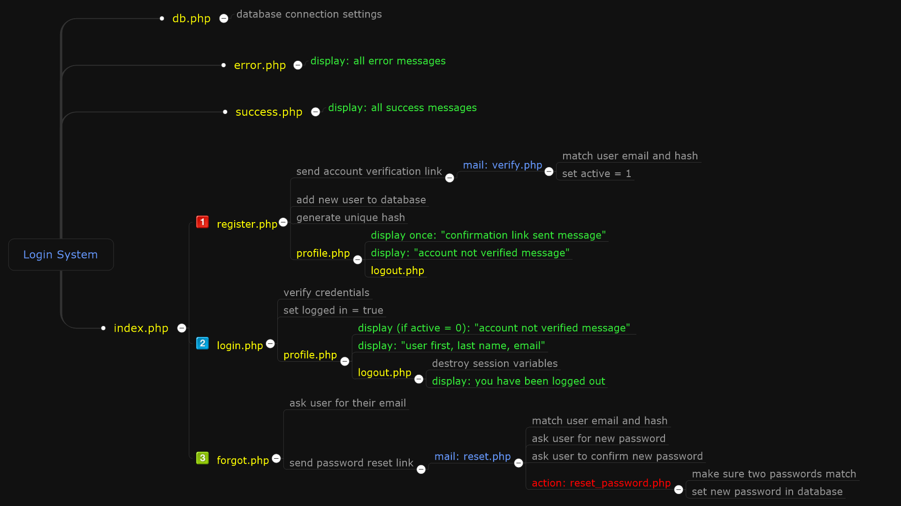

# PHP Login System

> A complete user authentication system in PHP and MySQL: registration with email verification, secure login, profile page and password reset.

## Features

- **Sign up** with first name, last name, email and password. Passwords are hashed with `password_hash()`.
- **Email verification:** a verification link with a random hash is sent by email (`verify.php`).
- **Log in** with `password_verify()` and PHP sessions. Only verified users can reach the profile.
- **Forgot password:** a reset link is emailed, then the user sets a new password (`forgot.php`, `reset.php`, `reset_password.php`).
- **Profile and logout** pages, plus clear success and error messages.

## How it works

## Run it

1. Copy the folder to `C:\xampp\htdocs\php-login-system` and start Apache and MySQL.
2. Create the database: open `http://localhost/php-login-system/sql/sql_import.php` once, or run the SQL in `sql/sql.txt`.
3. If your MySQL user has a password, set the environment variable `DB_PASSWORD` (defaults: user `root`, empty password, database `accounts`).
4. Open `http://localhost/php-login-system/`.

Sending verification emails needs a working mail setup in `php.ini` (SMTP).

## Author

**Ahmed Gamal Saber**, Full-Stack Web Developer & AI Engineer
[LinkedIn](https://linkedin.com/in/ahmed-gamal-saber-382081169) · [GitHub](https://github.com/AhmedGamal98)
